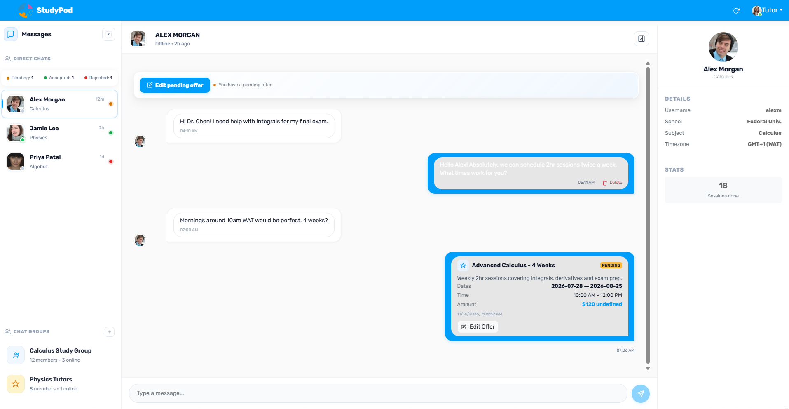

# StudyPod Tutor–Student Chat

A responsive chat interface for connecting tutors and students. The demo includes role-specific chat views, conversation lists, profile details, and tutoring offers.

## Live demo

[Open the StudyPod chat demo tutor](https://okeyodev.github.io/studypod-chat-modules/chat-tutor.html)

[Open the StudyPod chat demo student](https://okeyodev.github.io/studypod-chat-modules/chat-tutor.html)

## Preview



## Features

- Separate tutor and student chat views
- Demo conversations, profile details, and session statistics
- Send messages and create, edit, accept, or reject tutoring offers
- Responsive layout for desktop and mobile
- Demo data stored in the browser with cross-tab updates

## Run locally

The pages use JavaScript modules, so open them through a local web server rather than directly as `file://` URLs.

From the project directory, run:

```bash
py -m http.server 8000
```

Then open either view in your browser:

- Tutor: <http://localhost:8000/chat-tutor.html>
- Student: <http://localhost:8000/chat-student.html>

Open both views in tabs in the same browser to try the demo's cross-tab updates.

## Notes

This is a front-end demo. It uses browser `localStorage` for sample data and does not include authentication or a production backend. Use the reset button in the header to restore the demo data.
